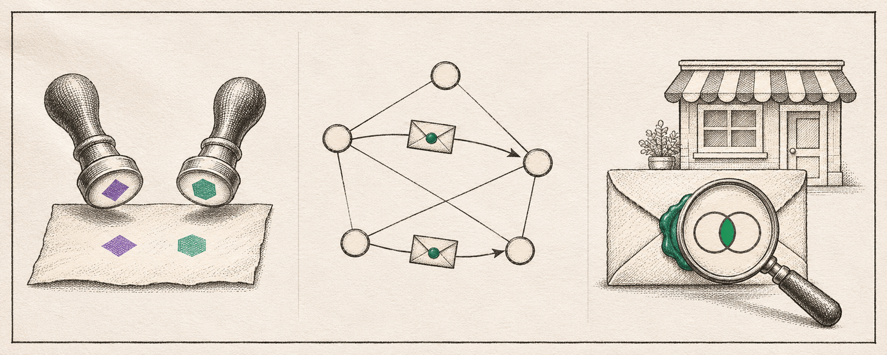

# Cachet

**Pay a person, not a string.** Link a Bitcoin Cash address to a Nostr key: both keys sign one statement, it lives on Nostr relays, and any wallet or app can verify it without asking a server.

Built for **BCH BLAZE 2026** (Mainnet Track & Paytaca Decentralized Identity Bounty). All code written Nov 14–22, 2026; no prior codebase.

| | |
|---|---|
| Slides | _add link_ |
| Live demo | [cachet-three.vercel.app](https://cachet-three.vercel.app) |
| EMBER2026 address | `bitcoincash:zzq4hd7sk4x32sxnusd7ch82d5c35fnwcg3ytwteug` |


## Try it

1. Open the site. The card on the right is a real binding made and verified in your tab.
2. **Sandbox demo** on the home page signs and publishes in one click (or **Create** with your own wallet → *Sign* → *Publish*). You get a profile page that anyone can verify. The *Try the whole loop* steps under the hero tick off as you go.
3. On the profile, **Pay**: default `1,000 sats`, scan the QR with any BCH wallet, or connect **Paytaca** over WalletConnect or **Selene** over WizardConnect. Incoming payments and supporter receipts update live via Fulcrum.
4. If you're running the example apps locally, open **Fieldnote** and **Stall**. *Sign in with Cachet* to unlock member articles on Fieldnote and open verified BCH seller checkout on Stall; share your `?seller=npub…` storefront URL so any buyer can verify it live from relays.
5. Back on your profile, **Withdraw**, then refresh the public profile to see its new state. If you signed in to the example apps, Stall's public `?seller=` storefront closes on refresh and pressing *Re-check* in either app ends the active session.
6. **Lab**: one honest binding and eleven attacks (stolen address, replayed proof, mirrored key, cached-verification bypass, unverified 30078…), each with the exact check it fails.

## Run locally

Node 22+.

```bash
npm install
```

Everything offline, against a local relay (no public relays touched):

```bash
npm run dev:local
```

Against public relays:

```bash
npm run dev
```

Cachet: http://localhost:5173 · Fieldnote: http://localhost:5174 · Stall: http://localhost:5175

```bash
npm test                         # verifier, relays, RP login, payments, lab, and deployment config
npm run typecheck
npm run verify -- fixtures/valid.json          # offline verifier
npm run verify -- --npub npub1…                # resolve from relays
```

Configuration: copy `apps/web/.env.example` to `apps/web/.env`. `VITE_WC_PROJECT_ID` (WalletConnect Cloud) enables wallet signing; without it people sign manually or use a sandbox key. `VITE_FEATURED_NPUB` puts a live identity on the home page.

## How it works



```
BCH wallet ──signs M──▶ statement {cashaddr, nostr_pubkey, network, issued_at, expires_at, nonce}
                              │
Nostr key ──signs──▶ kind 10011 event ["i", "bch:<cashaddr>", "<JCS proof>"] ──▶ relays (yours + defaults)
                                                                                  │
            wallets, apps, CLI ◀── newest snapshot by author, every check rerun locally
```

The full profile, checks and states are in [docs/PROTOCOL.md](docs/PROTOCOL.md). Wallet teams: [docs/WALLET_INTEGRATION.md](docs/WALLET_INTEGRATION.md).

| Package | Does | Never does |
|---|---|---|
| [`packages/core`](packages/core/src) | Statement, message, JCS, Bitcoin Signed Message, CashAddr, `verifyBinding`, `resolveSnapshots`, NIP-98 | network, keys, DOM |
| [`packages/discovery`](packages/discovery/src) | Per-relay queries with evidence, NIP-65, publish with acks, reverse lookup | sign anything |
| [`packages/signers`](packages/signers/src) | NIP-07, sandbox keys, WalletConnect `bch_signMessage` + `bch_signTransaction`; re-verifies every signer result | talk to relays |
| [`packages/pay`](packages/pay/src) | BIP21, Fulcrum watcher, unsigned P2PKH payment for WalletConnect & WizardConnect | hold keys |
| [`packages/react`](packages/react/src) | Identity card, check list, relay evidence, QR | |
| [`apps/web`](apps/web/src) | Create, profile and pay, lab, sign-in approval page | act as an identity server |
| [`apps/rp`](apps/rp) | Example relying party, run as Fieldnote and Stall | trust Cachet |
| [`tools/verify-cli`](tools/verify-cli/src) | Offline verification | |

Choices worth knowing:

- **NIP-39 kind 10011, not 30078.** NIP-78 keeps 30078 for app-private data; this is meant to be read by everyone.
- **Newest snapshot only.** A removed, expired or broken claim is never replaced by an older one that "still worked". Caches keep the newest snapshot so a stale relay cannot roll a reader back.
- **Separate keys enforced by x-coordinate**, which also catches `d` / `n−d`.
- **Every input is rebuilt** before verification; nostr-tools' per-object verification cache is never trusted.
- **Logins** use NIP-98 over the exact body plus a server nonce tied to the browser, consumed atomically. RPs keep their own sessions and re-check relays.
- **CashTokens-safe HD payments.** Wallet scans walk both receive and change chains across the BIP44 gap limit and exclude token-carrying UTXOs, so a BCH payment never misses coins in an active wallet or burns a CashToken.

## Verified end to end


Exercised live across BCH mainnet and public Nostr relays, with automated coverage described in [docs/COMPATIBILITY.md](docs/COMPATIBILITY.md):

- **Dual-key binding & discovery**: `bch_signMessage` over WalletConnect (Paytaca, Cashonize), manual Bitcoin Signed Message (Electron Cash), NIP-07 extensions (Alby, nos2x), and sandbox keys; published to public relays with two-wave NIP-65 discovery and Paytaca `kind 30078` upgrade detection.
- **Mainnet BCH checkout**: direct payments via **Paytaca** and **Cashonize** (WalletConnect `wc2-bch-bcr`), **Selene** (WizardConnect HD scanning), and standard **BIP21 QR / URI**, with live `0-conf` mempool and block-confirmation receipts over Fulcrum WebSockets.
- **Cross-app sign-in & instant revocation**: independent relying parties (**Fieldnote** and **Stall**) resolve relays directly, enforce atomic NIP-98 challenges, and end active sessions and seller checkouts as soon as a link is withdrawn.
- **Automated & adversarial checks**: `mainnet-js` / Electron Cash signature vectors, `fast-check` property invariants, relay fault injection, concurrent login-replay races across RP instances, offline CLI verification, and 11 forgery cases in the Lab.

## Deploy

**Vercel:** The live demo deploys the compiled frontend without connecting the private repository to Vercel. From a clean export of the repository root (no `.git` or local `.env` files), use Node 22 and the Vercel CLI:

```bash
vercel pull --yes --environment=production --project cachet --scope codeboy2006s-projects
VERCEL=1 vercel build --prod
vercel deploy --prebuilt --prod
```

The root `vercel.json` builds the web workspace and routes direct profile visits to the frontend. Set `VITE_WC_PROJECT_ID` in the Vercel project to enable WalletConnect.

**Fieldnote and Stall on Vercel:** Create a separate Vercel project for each app and connect the same Upstash Redis database to both production environments. The functions read `KV_REST_API_URL` and `KV_REST_API_TOKEN` (or `UPSTASH_REDIS_REST_URL` and `UPSTASH_REDIS_REST_TOKEN`) at runtime. Challenges, sessions, logs and verified relay snapshots are isolated by app origin. Never use `VITE_` for Redis credentials.

From the repository root, build each app's static frontend and compiled API into an otherwise empty, Vercel-linked deployment directory. For example, for Fieldnote (`a`; swap the two app origins and use `b` for Stall):

```bash
VITE_RP=a RP_VERCEL_ORIGIN=https://cachet-fieldnote.vercel.app \
VITE_SIBLING_URL=https://cachet-stall.vercel.app VITE_CACHET_URL=https://cachet-three.vercel.app \
npm run build:vercel -w @cachet/rp -- /absolute/path/to/linked-project/.vercel/output
```

In the linked deployment directory, run `vercel deploy --prebuilt --prod`. Verify both `/api/health` endpoints before setting `VITE_RP_A_URL` and `VITE_RP_B_URL` and rebuilding Cachet. Set `VITE_REPO_URL` on Cachet to show the Source link; the link does not grant access to a private repository.

**Persistent Node host:** The standalone demo and gateway still keep their app state in memory.

Set frontend origin variables (`VITE_CACHET_URL`, `VITE_RP_A_URL`, `VITE_RP_B_URL`) at build time so cross-origin sign-in links point to your live domains:

- **Separate processes**: `apps/web` is static (`npm run build -w @cachet/web` → `apps/web/dist`); `apps/rp` runs one Node process per app (`npm run build -w @cachet/rp`, then `RP=a ORIGIN=https://fieldnote.example PORT=… npm run start:a -w @cachet/rp`).
- **Single-process multi-origin gateway**: build with matching `VITE_*` origins, then `WEB_ORIGIN=https://cachet.example RP_A_ORIGIN=https://fieldnote.example RP_B_ORIGIN=https://stall.example PORT=3000 npm start` routes all three origins by `Host` header on one Node port while keeping separate cookies, challenges, and caches per origin.

MIT. Third-party licenses: [THIRD_PARTY_NOTICES.md](THIRD_PARTY_NOTICES.md).
